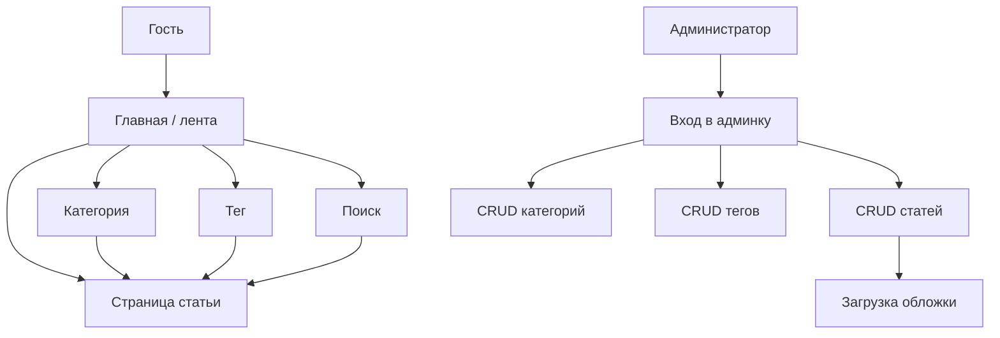
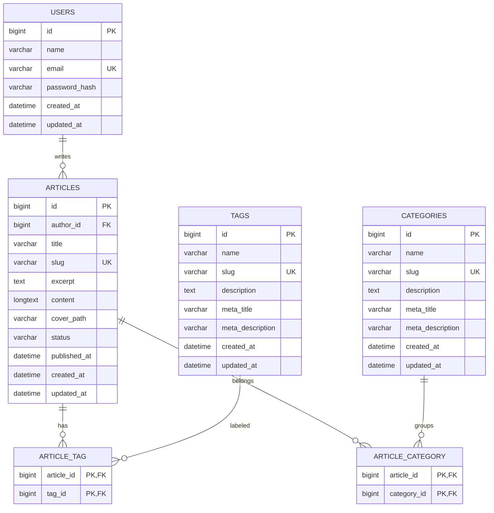
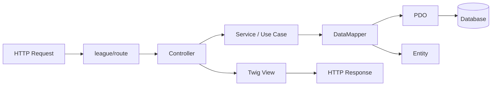

# Техническое задание: Веб-приложение «Блог»

## 1. Общие сведения

### 1.1. Цель проекта
Создание легковесного, быстрого и расширяемого веб-приложения «Блог» без использования тяжёлых фреймворков (Laravel/Symfony), с чистой архитектурой, явным управлением зависимостями и разделением ответственности между слоями приложения.

### 1.2. Целевая аудитория
| Сегмент | Потребности | Сценарии использования |
|---|---|---|
| Читатели (гости) | Быстрый доступ к контенту, удобная навигация, корректное отображение на мобильных устройствах | Просмотр ленты, чтение статей, переход по категориям/тегам, поиск |
| Администратор/автор | Удобное управление контентом без сложной CMS | Создание, редактирование, публикация и архивирование статей, управление категориями/тегами, загрузка обложек |
| Разработчик/сопровождающий | Понятная структура, простота расширения и поддержки | Добавление новых сущностей/страниц, изменение источника данных, доработка бизнес-логики |

### 1.3. Область применения (Scope)
**Входит в MVP:**
- Публичная часть: лента статей с пагинацией, страница статьи, страницы категорий и тегов, поиск (опционально, рекомендуется к реализации).
- Административная панель: аутентификация, CRUD статей/категорий/тегов, загрузка обложек статей.
- Работа с БД через кастомный DataMapper поверх PDO.
- SEO-базис: ЧПУ (slug), базовые meta-теги.

**Не входит в текущую версию (если не согласовано отдельно):**
- Комментарии, рейтинги, избранное.
- Мультиязычность.
- Роли кроме администратора, регистрация пользователей.
- Полноценная ORM, очереди, кеширование на внешних сервисах.

### 1.4. Стек технологий (строго)
| Компонент | Технология | Назначение |
|---|---|---|
| Язык | PHP 8.x (рекомендуется 8.2/8.3) | Бэкенд-логика |
| Шаблоны | Twig | Рендеринг HTML, автоэкранирование |
| Маршрутизация | `league/route` | HTTP-маршруты, middleware/стратегии ответов |
| БД | PDO + кастомный DataMapper | Доступ к данным без ORM (Doctrine/Eloquent не используются) |
| Конфигурация | `vlucas/phpdotenv` | Загрузка переменных окружения из `.env` |
| DI | `league/container` | Управление зависимостями и конфигурацией сервисов |
| Фронтенд | HTML5, CSS3, Bootstrap 5 | Адаптивная вёрстка |

**Используемые возможности PHP 8.x (обязательно):**
- **Typed properties** — строгая типизация свойств сущностей и сервисов.
- **Constructor property promotion** — сокращённое объявление зависимостей/свойств.
- **Union types** и **nullable types** (`?string`, `int|string`) — явные контракты данных.
- **Enums** (PHP 8.1+) — статусы статей (`Draft`, `Published`, `Archived`).
- **Readonly properties/classes** (где уместно) — неизменяемость DTO/значимых объектов.
- **`match` expression** — безопасная замена `switch` для маппинга статусов/форматов.
- **Named arguments** — читаемость при создании объектов/конфигурации.
- **Attributes** (опционально) — метаданные маршрутов/валидации при необходимости.
- **Strict types** (`declare(strict_types=1);`) — во всех PHP-файлах проекта.

## 2. Функциональные требования

### 2.1. Публичная часть

#### 2.1.1. Главная страница (лента статей)
- Отображение списка опубликованных статей, отсортированных по дате публикации (DESC).
- Для каждой статьи: обложка (если есть), заголовок, краткий анонс/фрагмент, дата публикации, категории, теги, ссылка на полную страницу.
- **Пагинация:** разбиение списка на страницы (размер страницы задаётся в конфигурации, по умолчанию 10).
- Отображение навигации по страницам (prev/next, номера страниц).

#### 2.1.2. Страница статьи
- URL по slug: `/post/{slug}`.
- Отображение: заголовок, обложка, дата публикации, дата обновления (опционально), автор, категории, теги, полный контент.
- Доступ только к опубликованным статьям; черновики/архив — 404.
- Блок «Похожие/другие статьи» (опционально).

#### 2.1.3. Страницы категорий и тегов
- Категория: `/category/{slug}` — название, описание категории, список связанных опубликованных статей с пагинацией.
- Тег: `/tag/{slug}` — название, описание тега, список связанных опубликованных статей с пагинацией.
- Статья может быть связана с несколькими тегами (M:M) и, при необходимости, с несколькими категориями.

#### 2.1.4. Поиск (опционально, рекомендуется)
- Страница `/search?q=...` с формой поиска.
- Поиск по опубликованным статьям (минимум: заголовок, анонс, контент) с использованием SQL `LIKE`/`FULLTEXT` (в зависимости от СУБД).
- Вывод результатов с пагинацией и подсветкой/отображением запроса.
- Пустой запрос — корректное сообщение/редирект на главную.

#### 2.1.5. Служебные страницы
- Страница 404 (Not Found) в едином шаблоне сайта.
- Корректные HTTP-коды ответов (200, 404, 400 при невалидных параметрах).

### 2.2. Административная панель

#### 2.2.1. Аутентификация
- Вход по email/логину и паролю (`/admin/login`).
- Выход (`/admin/logout`), завершение сессии.
- Защита всех маршрутов `/admin/*` (кроме login) middleware/проверкой авторизации.
- Хранение паролей только в виде хэша (`password_hash`, проверка `password_verify`).
- Защита форм входа и админ-действий от CSRF.

#### 2.2.2. CRUD статей (Articles)
- Список статей в админке: таблица (заголовок, статус, дата публикации/обновления, действия), фильтр по статусу, поиск по заголовку, пагинация.
- Создание/просмотр формы редактирования/обновление/удаление статьи.
- Поля:
  - `title` (обязательное)
  - `slug` (обязательное, уникальное; авто-генерация из title с возможностью правки)
  - `excerpt` (анонс)
  - `content` (основной текст)
  - `cover_image` (обложка, файл)
  - `status` (`draft` | `published` | `archived`)
  - `published_at` (дата/время публикации, nullable)
  - `created_at`, `updated_at` (служебные)
- Привязка к категориям и тегам (множественный выбор; создание тегов из справочника).

#### 2.2.3. CRUD категорий (Categories)
- Список, создание, редактирование, удаление.
- Поля: `name`, `slug` (уникальный), `description`, `meta_title`, `meta_description`.
- При удалении категории связи со статьями удаляются, сами статьи сохраняются.

#### 2.2.4. CRUD тегов (Tags)
- Список, создание, редактирование, удаление.
- Поля: `name`, `slug` (уникальный), `description` (опционально), `meta_title`, `meta_description`.
- При удалении тега связи со статьями удаляются, сами статьи сохраняются.

#### 2.2.5. Загрузка изображений (обложки статей)
- Загрузка файла обложки при создании/редактировании статьи.
- Сохранение в локальную директорию (например, `public/uploads/covers/YYYY/MM/`).
- Валидация: допустимые форматы (JPEG, PNG, WebP, GIF), лимит размера (задаётся в конфигурации), проверка MIME-типа (`finfo`).
- Генерация безопасного уникального имени файла; хранение относительного пути в БД.
- Удаление/замена обложки при обновлении статьи (с политикой очистки старых файлов).

### 2.3. Пользовательские сценарии (основные)


## 3. Требования к базе данных

### 3.1. Общие требования
- СУБД: MySQL 8.x / MariaDB 10.6+ (основная целевая), допустима адаптация под SQLite.
- Кодировка: `utf8mb4`, collation `utf8mb4_unicode_ci` (для MySQL/MariaDB).
- Первичные ключи: `BIGINT UNSIGNED AUTO_INCREMENT` (или эквивалент).
- Внешние ключи с осмысленной политикой `ON DELETE`/`ON UPDATE`.
- Индексы на `slug`, статусах, датах публикации и полях связей.
- Все запросы выполняются через подготовленные выражения PDO.

### 3.2. Сущности и поля

#### 3.2.1. `users`
| Поле | Тип | Ограничения | Описание |
|---|---|---|---|
| id | BIGINT UNSIGNED | PK, AUTO_INCREMENT | Идентификатор |
| name | VARCHAR(255) | NOT NULL | Имя автора/админа |
| email | VARCHAR(255) | NOT NULL, UNIQUE | Email/логин |
| password_hash | VARCHAR(255) | NOT NULL | Хэш пароля |
| created_at | DATETIME | NOT NULL | Дата создания |
| updated_at | DATETIME | NOT NULL | Дата обновления |

#### 3.2.2. `articles`
| Поле | Тип | Ограничения | Описание |
|---|---|---|---|
| id | BIGINT UNSIGNED | PK, AUTO_INCREMENT | Идентификатор |
| author_id | BIGINT UNSIGNED | NOT NULL, FK -> users.id | Автор |
| title | VARCHAR(255) | NOT NULL | Заголовок |
| slug | VARCHAR(255) | NOT NULL, UNIQUE | URL-идентификатор |
| excerpt | TEXT | NULL | Анонс |
| content | LONGTEXT | NULL | Контент |
| cover_path | VARCHAR(512) | NULL | Путь к обложке |
| status | VARCHAR(20) | NOT NULL | `draft/published/archived` |
| published_at | DATETIME | NULL | Дата публикации |
| created_at | DATETIME | NOT NULL | Дата создания |
| updated_at | DATETIME | NOT NULL | Дата обновления |

#### 3.2.3. `categories`
| Поле | Тип | Ограничения | Описание |
|---|---|---|---|
| id | BIGINT UNSIGNED | PK | Идентификатор |
| name | VARCHAR(255) | NOT NULL | Название |
| slug | VARCHAR(255) | NOT NULL, UNIQUE | Slug |
| description | TEXT | NULL | Описание |
| meta_title | VARCHAR(255) | NULL | SEO title |
| meta_description | VARCHAR(512) | NULL | SEO description |
| created_at | DATETIME | NOT NULL | Дата создания |
| updated_at | DATETIME | NOT NULL | Дата обновления |

#### 3.2.4. `tags`
| Поле | Тип | Ограничения | Описание |
|---|---|---|---|
| id | BIGINT UNSIGNED | PK | Идентификатор |
| name | VARCHAR(255) | NOT NULL | Название |
| slug | VARCHAR(255) | NOT NULL, UNIQUE | Slug |
| description | TEXT | NULL | Описание (опционально) |
| meta_title | VARCHAR(255) | NULL | SEO title |
| meta_description | VARCHAR(512) | NULL | SEO description |
| created_at | DATETIME | NOT NULL | Дата создания |
| updated_at | DATETIME | NOT NULL | Дата обновления |

#### 3.2.5. Связующие таблицы
| Таблица | Поля | Связь | Примечание |
|---|---|---|---|
| `article_tag` | `article_id`, `tag_id` | M:M (Articles ↔ Tags) | PK (`article_id`, `tag_id`), FK с `ON DELETE CASCADE` |
| `article_category` | `article_id`, `category_id` | M:M (Articles ↔ Categories) | PK (`article_id`, `category_id`), FK с `ON DELETE CASCADE` (расширение для гибкости) |

> Примечание: в базовом требовании явно указана связь многие-ко-многим для тегов; связь статей с категориями реализуется как M:M для масштабируемости (допустима адаптация до 1:M при согласовании, но модель должна быть описана и согласована).

### 3.3. ER-диаграмма


### 3.4. Индексы и ограничения (минимум)
- `articles.slug` — UNIQUE.
- `articles(status, published_at)` — для выборки ленты опубликованных статей.
- `categories.slug`, `tags.slug` — UNIQUE.
- FK: `articles.author_id -> users.id`, `article_tag.*`, `article_category.*`.

## 4. Архитектура и структура проекта

### 4.1. Архитектурный подход
- **Тонкие контроллеры:** принимают HTTP-запрос, вызывают сервисы/мапперы, возвращают ответ (Twig/redirect).
- **Доменная модель (Entities):** простые PHP-объекты с typed properties, без логики доступа к БД.
- **DataMapper:** отдельный слой, отвечающий за преобразование строк БД ↔ объекты сущностей и выполнение SQL через PDO.
- **DI-контейнер:** сборка и внедрение зависимостей (`PDO`, мапперы, сервисы, Twig, настройки).
- **Шаблоны:** Twig-иерархия (layout + страницы + partials), автоэкранирование включено.



### 4.2. Принцип работы кастомного DataMapper

**Цель:** отделить доменные сущности от логики хранения данных и SQL.

**Основные принципы:**
- **Entity (сущность)** — чистый объект предметной области (поля, геттеры/сеттеры или публичные readonly-свойства, простые методы), не знает о PDO/SQL/таблицах.
- **Mapper** — знает, как загрузить/сохранить сущность: содержит SQL, использует `PDO` и подготовленные выражения, маппит массивы строк в объекты и обратно.
- **Разделение ответственности:** контроллер/сервис оперирует сущностями и интерфейсами мапперов, не формируя SQL напрямую.
- **Идентичность (упрощённо):** в рамках запроса маппер может возвращать согласованные объекты; полноценный Identity Map/Unit of Work не обязателен для MVP, но архитектура не должна мешать их добавлению.
- **Транзакции:** выполняются на уровне сервиса/маппера при составных операциях (например, сохранение статьи + связей с тегами/категориями).

**Пример контракта и реализации (упрощённо):**
```php
<?php
declare(strict_types=1);

namespace App\Domain\Article;

enum ArticleStatus: string
{
    case Draft = 'draft';
    case Published = 'published';
    case Archived = 'archived';
}

final class Article
{
    public function __construct(
        public ?int $id,
        public int $authorId,
        public string $title,
        public string $slug,
        public ?string $excerpt,
        public ?string $content,
        public ?string $coverPath,
        public ArticleStatus $status,
        public ?\DateTimeImmutable $publishedAt,
        public \DateTimeImmutable $createdAt,
        public \DateTimeImmutable $updatedAt,
    ) {}
}
```

```php
<?php
declare(strict_types=1);

namespace App\Domain\Article;

interface ArticleMapperInterface
{
    public function findById(int $id): ?Article;
    public function findPublishedBySlug(string $slug): ?Article;
    /** @return Article[] */
    public function findPublishedPaginated(int $limit, int $offset): array;
    public function countPublished(): int;
    public function save(Article $article): void; // insert/update
    public function delete(Article $article): void;
}
```

```php
<?php
declare(strict_types=1);

namespace App\Infrastructure\Persistence;

use App\Domain\Article\Article;
use App\Domain\Article\ArticleMapperInterface;
use App\Domain\Article\ArticleStatus;
use PDO;

final class PdoArticleMapper implements ArticleMapperInterface
{
    public function __construct(private readonly PDO $pdo) {}

    public function findPublishedBySlug(string $slug): ?Article
    {
        $stmt = $this->pdo->prepare(
            'SELECT * FROM articles WHERE slug = :slug AND status = :status AND (published_at IS NULL OR published_at <= NOW()) LIMIT 1'
        );
        $stmt->execute(['slug' => $slug, 'status' => ArticleStatus::Published->value]);
        $row = $stmt->fetch(PDO::FETCH_ASSOC);

        return $row ? $this->hydrate($row) : null;
    }

    public function save(Article $article): void
    {
        // insert или update по наличию $article->id, внутри — подготовленные выражения PDO
    }

    public function findById(int $id): ?Article { /* ... */ return null; }
    public function findPublishedPaginated(int $limit, int $offset): array { /* ... */ return []; }
    public function countPublished(): int { /* ... */ return 0; }
    public function delete(Article $article): void { /* ... */ }

    /** @param array<string, mixed> $row */
    private function hydrate(array $row): Article
    {
        return new Article(
            id: (int) $row['id'],
            authorId: (int) $row['author_id'],
            title: (string) $row['title'],
            slug: (string) $row['slug'],
            excerpt: $row['excerpt'] !== null ? (string) $row['excerpt'] : null,
            content: $row['content'] !== null ? (string) $row['content'] : null,
            coverPath: $row['cover_path'] !== null ? (string) $row['cover_path'] : null,
            status: ArticleStatus::from((string) $row['status']),
            publishedAt: $row['published_at'] ? new \DateTimeImmutable((string) $row['published_at']) : null,
            createdAt: new \DateTimeImmutable((string) $row['created_at']),
            updatedAt: new \DateTimeImmutable((string) $row['updated_at']),
        );
    }
}
```

### 4.3. Примерное дерево каталогов
```text
project-root/
├─ public/
│  ├─ index.php                # Front controller (единая точка входа)
│  ├─ .htaccess                # Rewrite на index.php (Apache), при необходимости
│  └─ uploads/                 # Загруженные изображения (обложки)
├─ config/
│  ├─ container.php            # Регистрация зависимостей в league/container
│  ├─ routes.php               # Определение маршрутов league/route
│  └─ app.php                  # Общие настройки приложения
├─ src/
│  ├─ Http/
│  │  ├─ Controller/
│  │  │  ├─ HomeController.php
│  │  │  ├─ ArticleController.php
│  │  │  ├─ CategoryController.php
│  │  │  ├─ TagController.php
│  │  │  ├─ SearchController.php
│  │  │  └─ Admin/
│  │  │     ├─ AuthController.php
│  │  │     ├─ ArticleController.php
│  │  │     ├─ CategoryController.php
│  │  │     └─ TagController.php
│  │  ├─ Middleware/           # Auth, CSRF, error handling (при необходимости)
│  │  └─ Request/              # DTO/валидация входных данных (опционально)
│  ├─ Domain/
│  │  ├─ Article/              # Entity, ArticleStatus, ArticleMapperInterface
│  │  ├─ Category/
│  │  ├─ Tag/
│  │  └─ User/
│  ├─ Infrastructure/
│  │  ├─ Persistence/          # PdoArticleMapper, PdoCategoryMapper, PdoTagMapper, ...
│  │  ├─ Slug/                 # Генератор slug
│  │  └─ Upload/               # Сервис загрузки/валидации изображений
│  ├─ Service/                 # Сценарии использования (ArticleService и т.д.)
│  └─ Support/                 # Пагинация, хелперы, исключения
├─ templates/
│  ├─ layout/
│  │  ├─ base.html.twig
│  │  └─ admin.html.twig
│  ├─ public/                  # home, article, category, tag, search, 404
│  ├─ admin/                   # login, статьи/категории/теги (index/form)
│  └─ partials/                # pagination, flash, header, footer
├─ database/
│  ├─ migrations/              # SQL-миграции/схема
│  └─ seeds/                   # Начальные данные (админ-пользователь)
├─ var/
│  ├─ cache/                   # Кэш Twig (в prod)
│  └─ log/                     # Логи приложения
├─ .env                        # Локальная конфигурация (не коммитить)
├─ .env.example                # Шаблон переменных окружения
├─ composer.json
└─ README.md
```

### 4.4. Ответственность ключевых классов/компонентов
| Компонент | Ответственность |
|---|---|
| `public/index.php` | Bootstrap приложения: загрузка автозагрузчика, `.env`, контейнера, маршрутов; диспетчеризация запроса |
| `config/container.php` | Регистрация сервисов: `PDO`, Twig, мапперы, сервисы, контроллеры, параметры (uploads path, page size) |
| `config/routes.php` | Декларация HTTP-маршрутов (публичных и `/admin`), привязка к контроллерам, middleware |
| Controllers | Оркестрация запроса/ответа, валидация входных данных, вызов сервисов/мапперов, рендер Twig/redirect |
| Services (Use Cases) | Бизнес-сценарии: создание/публикация статьи, управление связями article-tag/category, транзакции |
| Domain Entities | Представление данных предметной области, типобезопасность (typed properties, enums) |
| Mapper Interfaces | Контракты доступа к данным для доменного слоя |
| PDO Mappers | SQL, prepared statements, hydrate/extract, работа с pivot-таблицами |
| Upload Service | Приём, валидация, сохранение и удаление файлов обложек |
| Twig Templates | Представление, переиспользуемые блоки, автоэкранирование вывода |

### 4.5. Конфигурация DI (`league/container`) — пример
```php
<?php
declare(strict_types=1);

use League\Container\Container;
use App\Infrastructure\Persistence\PdoArticleMapper;
use App\Domain\Article\ArticleMapperInterface;

$container = new Container();

// PDO
$container->addShared(PDO::class, function () {
    $dsn = sprintf('%s:host=%s;dbname=%s;charset=utf8mb4', $_ENV['DB_DRIVER'], $_ENV['DB_HOST'], $_ENV['DB_NAME']);
    $pdo = new PDO($dsn, $_ENV['DB_USER'], $_ENV['DB_PASS'], [
        PDO::ATTR_ERRMODE => PDO::ERRMODE_EXCEPTION,
        PDO::ATTR_DEFAULT_FETCH_MODE => PDO::FETCH_ASSOC,
        PDO::ATTR_EMULATE_PREPARES => false,
    ]);
    return $pdo;
});

// Mappers
$container->addShared(ArticleMapperInterface::class, PdoArticleMapper::class)
    ->addArgument(PDO::class);

// Twig, Controllers, Services регистрируются аналогично (через factory/auto-wiring по соглашению проекта)
return $container;
```

### 4.6. Конфигурация окружения (`.env`)
Пример `.env.example`:
```env
APP_ENV=local
APP_DEBUG=true
APP_URL=http://localhost

DB_DRIVER=mysql
DB_HOST=127.0.0.1
DB_PORT=3306
DB_NAME=blog
DB_USER=root
DB_PASS=secret

UPLOADS_PATH=/uploads/covers
UPLOAD_MAX_SIZE=5242880
PAGINATION_PER_PAGE=10
```
- `.env` загружается на старте через `vlucas/phpdotenv` (`$dotenv->load()` / `safeLoad()`).
- Валидация обязательных переменных (`DB_*`, `APP_URL`) при инициализации.

## 5. Нефункциональные требования

### 5.1. Безопасность
- **SQL-инъекции:** все запросы к БД — только через подготовленные выражения PDO (`prepare` + `execute`/bind), без конкатенации пользовательского ввода в SQL.
- **XSS:** автоэкранирование Twig включено по умолчанию; вывод «сырого» HTML (`|raw`) допускается только для доверенного/санитизированного контента с явной фильтрацией.
- **CSRF:** токены для всех state-changing форм админ-панели (POST/PUT/DELETE), проверка на сервере.
- **Аутентификация/сессии:** регенерация ID сессии при входе, безопасные параметры cookie (`HttpOnly`, `SameSite`, `Secure` в HTTPS), таймаут сессии.
- **Загрузка файлов:** whitelist расширений/MIME, ограничение размера, переименование файлов, запрет исполнения скриптов в директории uploads, хранение вне исполняемых контекстов где возможно.
- **Пароли:** `password_hash()` (bcrypt/argon2 по умолчанию PHP) и `password_verify()`.
- **Конфигурация:** `.env` и служебные директории недоступны напрямую из веба; `APP_DEBUG=false` в production.
- **Заголовки:** базовые security headers (рекомендуется: `X-Content-Type-Options`, `X-Frame-Options`, `Referrer-Policy`).

### 5.2. SEO
- **Чистые URL (slug):** человекочитаемые адреса для статей, категорий, тегов (`/post/{slug}`, `/category/{slug}`, `/tag/{slug}`).
- **Базовые meta-теги:** `<title>`, `<meta name="description">` для каждой публичной страницы.
- **Open Graph (рекомендуется):** `og:title`, `og:description`, `og:image`, `og:url` для страниц статей.
- **Canonical:** канонические URL для страниц контента и пагинации.
- **Семантика и индексация:** корректная иерархия заголовков (H1–H3), `alt` для изображений, `sitemap.xml` и `robots.txt` (рекомендуется в составе релиза).
- **HTTP-статусы:** 200 для существующих страниц, 404 для отсутствующих, 301/302 для редиректов при смене slug (опционально).

### 5.3. Производительность
- Лёгкий стек без тяжёлого фреймворка; минимальные накладные расходы bootstrap.
- Пагинация списков для ограничения объёма выборок и HTML.
- Индексация БД по полям выборок/сортировок (`slug`, `status`, `published_at`, FK).
- Выборка только необходимых полей/записей, отсутствие N+1 при выводе списков (предзагрузка связей в мапперах/сервисах по мере необходимости).
- Кэширование скомпилированных Twig-шаблонов в production (`var/cache/twig`).
- Оптимизация изображений обложек (ограничение размера, рекомендации по компрессии; ресайз — опционально).

### 5.4. Поддерживаемость и качество кода
- Единый стиль кода (PSR-12), строгая типизация, `declare(strict_types=1)`.
- Понятное разделение слоёв (Http / Domain / Infrastructure / Service).
- Обработка ошибок и исключений с логированием (`var/log`), пользовательские страницы ошибок.
- Минимальный набор автотестов для критичных компонентов (мапперы, slug, сервисы) — рекомендуется.

### 5.5. Совместимость
- Адаптивная вёрстка Bootstrap 5 (mobile-first), корректное отображение на экранах ≥ 320px.
- Поддержка актуальных версий браузеров: Chrome, Firefox, Safari, Edge.

## 6. Критерии приёмки

### 6.1. Функциональные критерии
1. **Публичная часть:** главная отображает ленту опубликованных статей с пагинацией; открывается страница статьи по slug; работают страницы категорий и тегов с пагинацией; поиск (если включён) возвращает релевантные результаты по опубликованным статьям; несуществующие ресурсы отдают 404.
2. **Админ-панель:** доступен вход/выход администратора; неавторизованный доступ к `/admin/*` запрещён. Реализованы CRUD для статей, категорий и тегов.
3. **Статьи:** поддерживаются поля и статусы (черновик/опубликовано/архив), slug уникален, опубликованные статьи видны публично, черновики и архив — нет.
4. **Связи:** статья может иметь несколько тегов (M:M) и категорий; связи корректно сохраняются и отображаются.
5. **Медиа:** загрузка обложки работает, файлы сохраняются локально, проходят валидацию, корректно отображаются на сайте.

### 6.2. Архитектурные и технические критерии
1. Используется заявленный стек: PHP 8.x, Twig, `league/route`, `vlucas/phpdotenv`, `league/container`, Bootstrap 5.
2. Доступ к БД реализован через кастомный DataMapper поверх PDO; ORM (Doctrine/Eloquent) не используются.
3. Сущности отделены от логики БД (мапперы отвечают за SQL и гидрацию).
4. Зависимости конфигурируются и разрешаются через DI-контейнер.
5. Структура проекта соответствует согласованному дереву (`src/`, `templates/`, `public/`, `config/` и др.) или обоснованно его развивает.

### 6.3. Нефункциональные критерии
1. **Безопасность:** SQL-запросы выполняются через prepared statements PDO; вывод в Twig экранируется; формы админки защищены CSRF; загрузка файлов валидируется; пароли хранятся как хэши.
2. **SEO:** реализованы ЧПУ (slug) и базовые meta-теги (`title`, `description`) для публичных страниц.
3. **UI:** интерфейс адаптивен (Bootstrap 5) и корректно отображается на мобильных и десктопных экранах.
4. **Качество:** приложение разворачивается по инструкции (`.env.example`, зависимости Composer, схема БД), отсутствуют критические ошибки при прохождении основных сценариев.

### 6.4. Артефакты сдачи
- Исходный код репозитория.
- `.env.example` и инструкция по развёртыванию.
- SQL-схема/миграции БД и (опционально) seed администратора.
- Краткая документация по архитектуре и ключевым настройкам (README).
